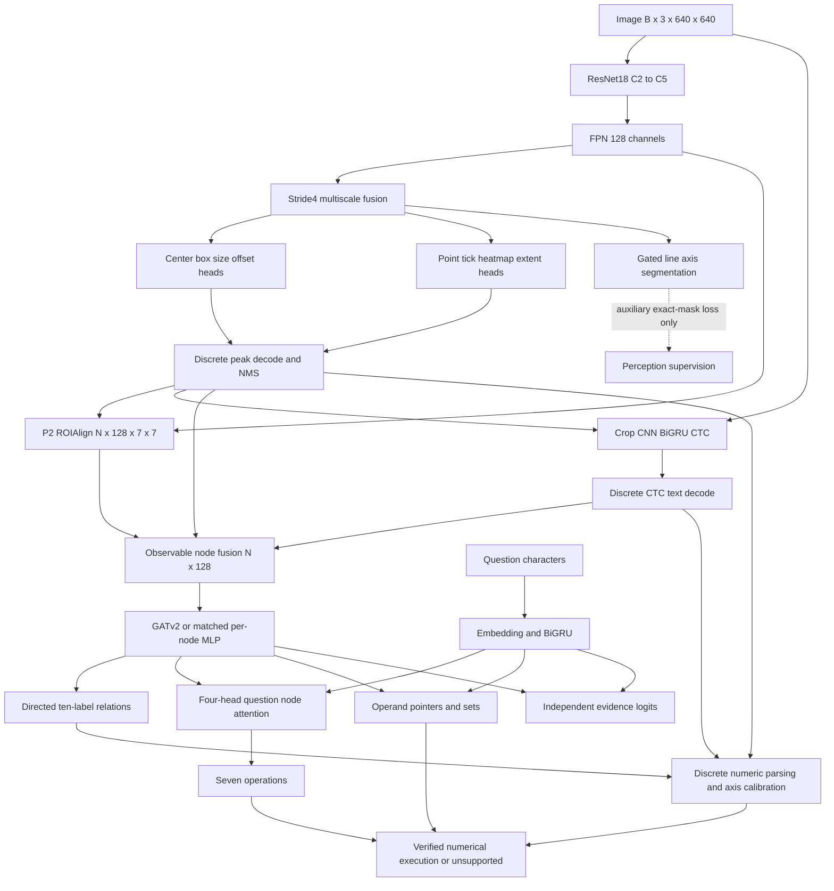

# SenseGraph-Net — complete neural architecture specification

Status: **design and random-weight CPU tensor verification, not a trained model**. Target: seven-operation synthetic chart QA with explicit unsupported results. This is a neural architecture specification, not an application, deployment, API or database design. No pretrained weights were acquired and no optimizer steps or GPU runs were executed for this document.

Executable companion: [`neural_spec.py`](../src/sensegraph/neural_spec.py). Audit: `experiments/neural_architecture/audit.json`. The skeleton instantiates every neural module with random weights, including ResNet, without network access. Discrete decoding, target generation, matching, crop preparation, calibration and execution are specified below rather than disguised as learned functionality. The forward skeleton accepts observable proposals at the decoder boundary; this is **not** an operational trained image-to-answer pipeline.

## 1. Evidence and choices

| Executed finding | Architectural consequence and limits |
| --- | --- |
| M3 GATv2 macro F1 .7629 vs MLP .7409; conditional paired advantage +2.202 percentage points | Keep graph message passing as a hypothesis and a matched MLP as mandatory control. These are synthetic oracle-proposal results only. |
| Complete connectivity scored .7915 at one seed | Predeclare complete and spatial-six graphs; do not select a winner from the previous test after the fact. |
| M4 recall: bar .407, segment .469, text .163, point/tick zero; macro recall .170, AP50 .113 | Preserve stride-4 spatial features, separate keypoints from boxes, explicitly evaluate small/rotated text. |
| M4 froze backbone/ROI features, used 320 input and only 240 development steps | Failure does not isolate Faster R-CNN, pretraining, duration or resolution as the cause. Center-based detection is a proposed alternative, not an established improvement. |
| M3 equality F1 remained weak | Report `equal_to`; keep structural classification distinct from verified numeric comparisons. |
| Segment labels enclose strokes; series nodes are renderer unions | Never train segmentation from rectangle fills or demand a detector identify unpainted series aggregates. |

**Reference choice:** ResNet-18 + 128-channel FPN at 640 pixels. A small, pretrained CNN is an interpretable middle ground between the under-adapted MobileNet experiment and a much larger ViT/Swin. Stride-4 preserves information, but tiny ticks still may occupy less than one cell. CenterNet-style heads avoid anchors; they introduce center collisions and peak/NMS choices. No claim that they solve perception is warranted before controlled comparison.

**Question choice:** train a character BiGRU for the seven current operations; no pretrained language model. This is appropriate for bounded templated questions, not open-domain language comprehension. Paraphrase, character-length and unsupported-operation evaluation are required before any language-generalization claim.

Prior evidence: [M3 report](milestone3_report.md), [M4 report](milestone4_report.md), [supervision contract](structural_data_schema.md), [partial real annotations](real_annotation_mapping.md).

## 2. Input and output contract

Let B be charts, Q questions, N the total physical nodes, K the maximum nodes in any chart, E=Σn_b(n_b−1), M message edges, T OCR crops. Default B=1–2, n_b≤128, question length≤128.

| Tensor | Shape / meaning |
| --- | --- |
| `images` | `[B,3,640,640]` float32 ImageNet-normalized RGB |
| `rgb` | Same shape, original `[0,1]` pixels for crop color and OCR preparation; never measure RGB means on normalized values |
| Question IDs / lengths / chart | `[Q,128]` int64 / `[Q]` / `[Q]` int64 |
| Decoded boxes | List of B tensors `[n_b,4]`, detached continuous xyxy in padded-image pixels |
| Predicted type probabilities / confidence | `[N,7]` / `[N,1]`; no true types |
| Recognized text IDs / availability | `[N,L]` / `[N]`, availability 0 or 1; zeros when absent |
| OCR crops | `[T,1,32,128]`; optional; logits `[T,32,96]` |
| Dense outputs | Seven maps described in the layer table; unactivated logits/regressions |
| Nodes / observable features | `[N,128]` / `[N,11]` |
| Messages / message attributes | `[2,M]` / `[M,8]` |
| Directed candidates / relation logits | `[2,E]` / `[E,10]` |
| Operation logits | `[Q,7]`, following existing `OPERATIONS` order |
| Operand A / B logits | Each `[Q,K+1]`; last entry is null; invalid padded entries −∞ |
| Evidence logits / mask | `[Q,K]` / `[Q,K]`; null is not evidence |
| Unsupported-empty flag | `[Q]`; downstream execution must abstain for these questions |

Character vocabulary: blank 0; ASCII 32–126 mapped to IDs 1–95; unknown 96; pad 97. OCR's 96 output classes are blank plus printable ASCII, excluding unknown/pad. Unicode beyond this set is unsupported by the OCR recognizer. Question strings outside length/charset support must be flagged, not silently truncated into a supposedly supported question.

Resize aspect-preservingly to fit 640×640; round resulting dimensions, center-pad with white RGB; then normalize by mean (.485,.456,.406), std (.229,.224,.225). Keep actual `sx=new_width/original_width`, `sy=new_height/original_height`, and left/top padding, not a guessed single scale after rounding. Apply those exact affine transforms and their inverse to coordinates. Valid-pixel masks exclude padding from dense targets and decoding. Crop RGB comes from the pre-normalization padded tensor.

No source IDs, true types, numerical values, source calibration matrices, semantic adjacency, QA answers or evidence enter inference. Boxes supplied to the skeleton can be controlled fixtures; results from those fixtures prove wiring only.

## 3. Detailed layer specification

All convolutions have dilation 1 and groups 1. New hidden convolution blocks: bias=False, GroupNorm(8,C), ReLU. Output Conv1×1: bias=True, no norm/activation. Dropout is disabled at evaluation. FPN convolution biases are enabled, with no normalization or activation. ResNet uses its standard BN epsilon 1e−5 and momentum .1; **running statistics remain frozen** during small-batch fitting.

| Stage | Every operation / repeat definition | Output for B charts at 640 |
| --- | --- | --- |
| Stem | Conv7×7 3→64, stride2, padding3, no bias; BN64; ReLU; MaxPool3×3 stride2 padding1 | `[B,64,160,160]` |
| C2 / layer1 | BasicBlock(64→64,s1) twice | `[B,64,160,160]` |
| C3 / layer2 | BasicBlock(64→128,s2), BasicBlock(128→128,s1) | `[B,128,80,80]` |
| C4 / layer3 | BasicBlock(128→256,s2), BasicBlock(256→256,s1) | `[B,256,40,40]` |
| C5 / layer4 | BasicBlock(256→512,s2), BasicBlock(512→512,s1) | `[B,512,20,20]` |
| FPN laterals L2–L5 | Independent Conv1×1 from 64/128/256/512→128, stride1, padding0 | Four 128-channel maps |
| Top-down FPN | T5=L5; Ti=Li+nearest_resize(Ti+1, size(Li)), i=4,3,2 | Strides4/8/16/32 |
| FPN outputs P2–P5 | Independent Conv3×3 128→128, stride1, padding1 on each Ti | `[B,128,160/80/40/20,160/80/40/20]` |
| High-resolution fusion | Bilinear-resize all Pi to P2 size, align_corners=False; mean four maps; Conv3×3 128→128 s1 p1, GN8, ReLU | `[B,128,160,160]` |
| Box center | Independent Conv3×3 128→128 s1 p1, GN8, ReLU; Conv1×1 128→5 | `[B,5,160,160]` |
| Box size | Same hidden structure, independent weights; Conv1×1 128→10 | `[B,10,160,160]` |
| Box offset | Same; Conv1×1 128→10 | `[B,10,160,160]` |
| Keypoint heatmap | Same; Conv1×1 128→2 | `[B,2,160,160]` |
| Keypoint offset | Same; Conv1×1 128→4 | `[B,4,160,160]` |
| Keypoint extent | Same; Conv1×1 128→4 | `[B,4,160,160]` |
| Segmentation, gated | Same; Conv1×1 128→2 | `[B,2,160,160]` |
| ROI sampling | P2 `roi_align`, output7×7, scale .25, sampling_ratio2, aligned=True | `[N,128,7,7]` |
| Visual pooling | Mean of 49 ROI bins, no projection | `[N,128]` |
| Node fusion | Linear212→128 bias; LayerNorm128 eps1e−5; GELU; Dropout .15 | `[N,128]` |
| GAT blocks ×3 | GATv2Conv128→4×32; ELU; add input residual; LayerNorm128 | `[N,128]` |
| Directed relation head | Linear264→256; ReLU; Dropout .15; Linear256→128; ReLU; Linear128→10 | `[E,10]` |
| Question embedding | Embedding98×64, pad97; no position embedding | `[Q,128,64]` |
| Question GRU | Packed one-layer bidirectional GRU64→64/direction; concatenate final directional states | `[Q,128]` |
| Question attention | MHA128, four heads of32, dropout .1, batch_first=True, biases=True; queries `[Q,1,128]`, keys/values nodes plus null | `[Q,1,128]` |
| Operation | Concatenate original question and context; Linear256→128; GELU; Dropout .1; Linear128→7 | `[Q,7]` |
| Operand projections | QA128→128, QB128→128, shared K128→128; all bias=False; scaled dot products | Two `[Q,K+1]` |
| Evidence projections | QE128→128, KE128→128, bias=False; scaled dot products; exclude null | `[Q,K]` |
| Null | One learned vector of128 zeros initially | `[128]` |

BasicBlock(cin→cout,s): Conv3×3 cin→cout, stride s, padding1, no bias → BN → ReLU → Conv3×3 cout→cout stride1 padding1, no bias → BN → add shortcut → ReLU. Shortcut is identity when shape permits; otherwise Conv1×1 cin→cout stride s, no bias → BN. There are eight such blocks, sixteen 3×3 convolutions and three projection shortcuts. No classifier, global average pooling or dropout from the classification backbone is used.

Box class order: bar, text, legend-label, line-segment envelope, axis. Keypoint order: point, tick. The node seven-type order follows those five then those two. These are predicted physical categories, not the ten renderer node types. Text subtypes are not injected from labels. All ten existing relation classes retain their existing order, and remain visible even when a class has no recoverable positive endpoints.

### OCR network and text fusion

| OCR layer | Kernel / stride / padding; normalization | Output |
| --- | --- | --- |
| Crop preprocessing, non-neural | RGB→gray .299R+.587G+.114B; aspect fit and pad to32×128; crop-width validity retained | `[T,1,32,128]` |
| Conv1 | 1→32; 3×3 / (2,2) /1; GN8, ReLU | `[T,32,16,64]` |
| Conv2 | 32→64; 3×3 / (2,2) /1; GN8, ReLU | `[T,64,8,32]` |
| Conv3 | 64→128; 3×3 / (2,1) /1; GN8, ReLU | `[T,128,4,32]` |
| Conv4 | 128→128; 3×3 / (2,1) /1; GN8, ReLU | `[T,128,2,32]` |
| Height pooling / transpose | Mean height, channels last | `[T,32,128]` |
| BiGRU | One layer, input128, hidden64/direction; GRU gate sigmoid/tanh, no dropout | `[T,32,128]` |
| CTC output | Linear128→96 bias | `[T,32,96]` |
| Recognized text embedding | CTC discrete decode → shared question Embedding98×64 → mean valid character embeddings | `[N,64]` |

At most 32 CTC timesteps: target character length **plus adjacent-repeat count** must fit the valid input length. Record infeasible targets; do not hide them with zero_infinity. Respect valid resized crop width when setting CTC input lengths. Long text needs an independently versioned wider recognizer, not fabricated recognition. Rotated labels, Unicode and long titles are explicit risk subsets; no rectification or rotation invariance is claimed. Missing/invalid OCR gets zero features and availability0, including no text for non-text proposals. Shared character embeddings are registered only once, under `questions`.

Node input order (212): normalized box xyxy4, center2, size2, raw crop RGB3 =11; predicted type probabilities7; confidence1; ROI128; recognized text64; availability1. The skeleton's concatenation is exactly `[11,7,1,128,64,1]`.

### Graph mechanics and fair MLP

Each GAT is `GATv2Conv(128,32,heads=4,concat=True,negative_slope=.2,dropout=.15,edge_dim=8,share_weights=False,add_self_loops=True,fill_value=0.,bias=True,residual=False)`. External residual: `LN(h + ELU(layer(h, messages, edge_attr)))`. Eight pair features: signed center displacement2, absolute displacement2, signed width/height difference2, IoU1, RGB distance1. Self-loop attributes are zeros. No target adjacency or numerical value features.

\[
e_{ij}^h=a_h^T\operatorname{LeakyReLU}(W_s^hh_i+W_t^hh_j+W_e^he_{ij}),\quad
\alpha_{ij}^h=\operatorname{softmax}_{j\in\mathcal N(i)}e_{ij}^h.
\]

Attention-weight dropout .15 is applied as in PyG; concatenate four weighted sums of projected neighbor features. Unlike M3, observable edge attributes now enter message attention as well as classification. Test this change separately.

Messages: six nearest incoming neighbor centers per chart, self-loops added internally. Candidates: every ordered non-self pair, not just message edges. Chunk classifier evaluation at4,096 edges. Candidate chunking does not remove retained training activations when concatenating all chunks; streamed loss accumulation/checkpointing is needed for a genuine training-memory bound.

Matched MLP substitutes three blocks `LN(h + ELU(Linear128→128(ELU(Linear128→128(h)))))`. Graph-stack counts: MLP99,840 vs GAT103,680 (3.7% smaller); all other modules and inputs identical. Common node and relation dropout .15 retained. GAT additionally has attention dropout; include dropout-zero comparisons in a controlled protocol rather than claiming perfect stochastic equivalence. No per-node pooling across charts in the MLP.

Series unions are not proposals. Pairwise same-series grouping is a **future auxiliary label/head**, not a silent renaming of `belongs_to`. This skeleton keeps the ten original relation logits and does not implement new grouping supervision. Missing aggregate endpoints count as missed relations in end-to-end evaluation. Seven-operation operand sets can select physical marks without constructing a series node; predicting the correct set still requires training and evidence.

## 4. Explicit non-neural boundaries and forward equations

The following operations have zero trainable parameters and are not hidden implemented capabilities in the skeleton:

1. **Peak decode:** sigmoid center/keypoint heatmaps; 3×3 local maximum filter; exclude padded pixels; candidate confidence≥.10 (development default, freeze validation-selected thresholds before evaluation). For box class c at grid(u,v), center=4·((u,v)+sigmoid(offset_c)); size=4·softplus(size_c), minimum 1e−3 pixel. Decode keypoints analogously using their separate extent/offset pairs. Clip to valid-image rectangle, discard degenerate boxes. Per-class NMS IoU .5; deterministic score/index ties; global cap128 **before NMS**, retain up to128 survivors. Report cap truncation and duplicates. Seven-type probabilities are normalized seven class heatmap scores sampled at the decoded center; confidence is the originating peak score. No ground-truth type is inserted.
2. **Segmentation:** produce stride-4 line/axis probabilities only when exact stroke masks exist. Initially auxiliary loss only; it must not create unvalidated instance graphs. Extracting axes/segments from merged strokes needs a separately validated instance-association method. Box-envelope proposals remain the reference graph input even with this auxiliary branch active.
3. **ROI/crop preparation:** use decoded boxes; keep predicted coordinates detached. ROIAlign P2 visual features; pixel OCR crops are separate, grayscale aspect-fit. Supervised GT crops may be used for OCR training only and must be labeled as such.
4. **CTC decode:** greedy argmax path, collapse adjacent repeats before removing blanks; validate charset/length. Map each recognized string back to its predicted text proposal. Embedding pooling has a gradient to the character table but not to argmax or the OCR network.
5. **Graph construction:** normalize geometry by padded width/height; crop means from raw RGB; build messages/candidates per chart, offset node indices for batching. True types/relations never decide neighbors. Degree ties use stable proposal order; the sparse graph is not guaranteed permutation-equivariant for exact distance ties. Complete-graph and fixed-edge neural permutation checks remain valid.
6. **Operand selection:** operation and calibrated thresholds fixed from validation. Singleton slots use softmax over valid nodes plus null; set slots use sigmoid over valid nodes, null ignored. Empty required set or missing singleton means unsupported. Do not force a value from an empty chart.
7. **Numeric extraction:** parse recognized numbers with explicit sign/decimal/percent/unit policy; percent strings yield percentage points, incompatible units reject. Predicted `labels` and `maps_to_axis` relations associate tick labels and physical axes. Use ≥2 distinct numeric ticks to fit `v=a·p+b`; require ≥3 for a consistency-checked calibration and otherwise label two-point result unverified. Default QA execution requires ≥3. Least-squares normalized residual ≤1% of observed value span, nonzero span and consistent order are required; thresholds must be frozen before evaluation. Reject logarithmic/ambiguous axes. No renderer affine matrix is permitted.
8. **Mark values:** points use predicted center; bars require predicted physical axis line and a baseline consistent with its calibration, choosing the box edge farther from that baseline. A thick enclosing axis rectangle is not by itself a precise axis-line estimate; if centerline/baseline is ambiguous, abstain. All-negative charts, horizontal bars and truncated axes need separate validation. Numeric comparisons from extracted values do not replace learned relation scores in structural evaluation.
9. **Verified execution:** existing order lookup, maximum, minimum, absolute difference, greater-than comparison, count, signed series-sum difference. Lookup(A); max/min over A values (ties preserved in evidence); abs(A−B); A>B; cardinality(A); sum(A)−sum(B). Reject missing/calibration-invalid values for numeric operations; counting does not require numeric calibration. Evidence is separately predicted supporting physical nodes. No generative answer regressor.

\[
P=\operatorname{FPN}(\operatorname{ResNet18}(I)),\quad F=\operatorname{ConvGNReLU}(\tfrac14\sum_{i=2}^5\operatorname{resize}(P_i)).
\]
\[
r_i=\operatorname{mean}(\operatorname{ROIAlign}(P_2,b_i)),\quad
h_i^0=\operatorname{Dropout}(.15)(\operatorname{GELU}(\operatorname{LN}(W_f[x_i,t_i,c_i,r_i,o_i,m_i]))).
\]
\[
\ell_{ij}=\operatorname{MLP}([h_i,h_j,e_{ij}]),\quad p_{ij}=\sigma(\ell_{ij}),\quad
z_q=\operatorname{MHA}(q,H,H),\quad p_{op}=\operatorname{softmax}(\operatorname{MLP}([q,z_q])).
\]
Operand logits `QA(q)·K(h)/sqrt128` and `QB(q)·K(h)/sqrt128`; evidence `QE(q)·KE(h)/sqrt128`. These five projections are independent except the shared operand K. Pointer queries use original q; cross-context directly conditions operation classification, not pointer logits. Graph nodes already contain chart context. An explicit context-conditioned pointer is a later ablation, not an undocumented parameter change.

### Complete skeleton connection example

```python
from sensegraph.neural_spec import SenseGraphNet

model = SenseGraphNet(architecture="gat", connectivity="spatial").eval()
# All tensors below are observable; proposal decoding/OCR strings are DISCRETE inputs.
out = model(images, rgb, boxes, predicted_type_probabilities, confidence,
            recognized_ids, ocr_available, question_ids, lengths, question_chart,
            ocr_crops=prepared_gray_crops)
# out includes dense maps, nodes, candidates, relation logits, reasoning, OCR logits.
```

`encode_image` implements backbone/FPN/fusion/heads; `CropCTCRecognizer` implements all OCR layers; `CharacterBiGRU` owns the shared embedding and packed question encoder; `GraphStack128` implements GAT/MLP; `QuestionNodeReasoner` pads graphs, adds the always-valid learned null key, masks pointers/evidence, and flags empty charts. `SenseGraphNet.forward` implements ROI pooling, crop RGB/geometry, node fusion, per-chart graph construction, chunked directed classification and reasoning. See the executable companion for every helper body; it contains no `pass`, hidden trained model or download fallback. Images with no proposals have finite operation logits but must execute as unsupported; invalid evidence positions are intentionally −∞, not finite valid scores.

### Gradients

Dense supervised losses reach their heads, FPN and any unfrozen backbone. ROI task losses reach node/graph/question modules and sampled image features when unfrozen; decoded boxes are explicitly detached. Top-k, peak selection, NMS, crop coordinates, matching, graph connectivity, OCR decoding, numeric parsing/calibration selection, operand selection and execution are discrete. PyTorch ROIAlign is not assumed to differentiate proposal coordinates. CTC directly trains OCR; QA does not backpropagate through recognized strings into OCR. Fixed RGB means may expose image gradients but do not create coordinate gradients. This is a multi-stage trainable network, **not fully differentiable answer execution**.

## 5. Objectives, label availability and stage policy

Normalize by valid supervised targets, never by padding. Empty supervision contributes zero loss through a graph-connected zero where needed; do not average an empty tensor. Freeze train-only positive weights before validation. Exclude masked −∞ logits before BCE; never multiply infinite losses by zero masks.

| Objective | Definition / default weight | Supervision and restrictions |
| --- | --- | --- |
| Center and keypoint | Modified focal: positive `−(1−p)^2 log p`; negative `−(1−y)^4 p^2 log(1−p)`; each weight1 | Typed centers; Gaussian targets, positive at exact grid cell; clamp logs numerically |
| Size and key extent | SmoothL1 beta1 on positive feature-unit sizes; weight .1 | Positive-area widths/heights; no guessed stroke padding for invalid real labels |
| Subcell offsets | L1 on sigmoid predictions; weight1 | Fractional cell coordinates; positive centers only |
| Segmentation | BCEWithLogits + soft Dice, weight1; Dice smoothing1 | Exact renderer stroke masks only; disabled for v2/v3 rectangles |
| OCR | CTC blank0, weight1 | Trusted crop/transcription pairs; feasible input lengths; no invented GT transcription |
| Relations | BCEWithLogits, weight1, `pos_weight=clip(neg/pos,1,50)`; absent positives weight1 | Matched directed multi-hot labels; partial real missingness masked |
| Operation | Cross-entropy, weight1 | Seven labels in original order |
| Operand singleton | Cross-entropy, weight1 per active slot | Ordered operand node match; inactive slot null |
| Operand set | BCEWithLogits over valid physical nodes, weight1 per active slot | Membership targets; null ignored, no arbitrary tie winner |
| Evidence | BCEWithLogits, weight1 | Existing declared sufficient evidence policy; not human minimal evidence |

At a center cell let Gaussian radius=max(1, floor(min(w,h)/12)) in feature units (truncated at3 radii, sigma=radius/3); keypoint radius1. Mask padding. Count and preserve same-class center-cell collisions in target-generation reports; do not overwrite with one arbitrary object. Exclude conflicting regression targets from their losses, retain collision count and full evaluation denominators. If collision rate exceeds1% of any class, stop to redesign representation/resolution under a new protocol. This is a declared baseline target rule, not a faithful reproduction of every CenterNet heuristic.

Singleton missing-match questions are masked from node-supervised CE but retained as end-to-end QA failures; report training eligibility/coverage. Maximum/minimum use all relevant marks as operand set, not one chosen extreme; count selects Series1 observations; series difference uses disjoint ordered Series1/Series2 sets. Unknown aggregate node/evidence targets remain unavailable and lower evidence coverage. Never present physical-only evidence recall as complete original-evidence recall.

**New target version required:** exact line/axis stroke coverage from renderer paths and stroke widths, text crop/transform metadata, collision reports, and inverse-coordinate checks. This task does not generate it. Until validated, segmentation parameters are present for counting but frozen and their loss disabled. Teacher boxes/types/strings may supervise isolated components; oracle training inputs must be explicitly labeled and replaced by matched predicted inputs for non-oracle experiments. No source attributes enter deployed forward inputs.

### Initialization and freeze/unfreeze schedule

Future pretrained choice: `ResNet18_Weights.IMAGENET1K_V1`. Load backbone weights **after** constructing/initializing the new skeleton so generic initialization does not overwrite them. The current skeleton deliberately uses `weights=None`; it has no downloading path. No M3/M4 checkpoints are shape-compatible transfers for this architecture.

New Conv: Kaiming normal; new Linear and attention projections: Xavier uniform, zero biases; GRU input Xavier, recurrent gate matrices orthogonal, biases0; GAT uses PyG initialization. Heatmap biases logit(.01)=−4.595; output regression biases0 except extent/size softplus-inverse(4), representing an initial16-pixel extent. This is a prior, not guaranteed initial output size. Offset sigmoid initial prior .5. Null initialized0; shared padding embedding0. GN/LN weights1, biases0. BN running moments fixed; when C4/C5 are unfrozen this reference also freezes their BN affine parameters.

| Stage | Trainable modules, epoch cap and selection |
| --- | --- |
| Warm-up | FPN, fusion, six active dense heads; ResNet frozen; 5 epochs |
| Perception | C4/C5 except BN affine, FPN/fusion/heads; max30 additional epochs; macro detection AP50 primary, per-class keypoint/box recall guardrails |
| OCR | OCR CNN/BiGRU/output only; max30 epochs; validation character error rate primary, numeric exact transcription/rotation subsets required |
| Structural | Perception/OCR/shared character table frozen; node fusion, GAT or matched MLP, relation head; max50 epochs; validation macro relation AP primary |
| Reasoning | Character embedding/question GRU, question attention/op/pointer/evidence only; max30 epochs; validation operation+operand exact program accuracy primary, report executor coverage |
| Joint structural + reasoning | Above two downstream groups; optional max10 epochs at1e−4; no test-based promotion |
| Optional shared feature adaptation | Separate preregistered continuation, max10 epochs, C4/C5+FPN and downstream groups; keep direct perception losses, require no >.01 absolute validation AP50 drop; reject continuation if guard fails |

One epoch is one pass through the declared training chart inventory; sample all chart questions during reasoning, accumulate per-chart normalized losses and report chart/question exposures separately. Do not call240 updates a meaningful convergence study. 1,400 charts imply1,400 microbatches at B1 or700 at B2, effective batch8 by accumulation8 or4 respectively; optimizer updates175/epoch, with partial accumulation handled explicitly.

Perception AdamW: new-module LR3e−4, unfrozen backbone1e−5, weight decay1e−4, first epoch linear warmup, cosine decay to1% initial LR, norm clip1. OCR/reasoning LR3e−4; structural LR1e−3; all use same weight decay/clip and fixed caps. Validate once/epoch; after minimum5 epochs, stop for5 epochs without ≥.5% relative improvement (for minimized CER, relative decrease); at zero baseline use absolute1e−4 to avoid undefined ratios. Choose earliest best validation checkpoint. Calibrate relation/operand/evidence thresholds on validation only, then seal before independent test. Proposed epochs are not permission to exceed resource budgets.

Training must not bypass M4's failed gate. A new frozen perception/target protocol and validated data are prerequisites. Approximately38 minutes remain in the existing lifetime GPU allocation; this may allow only profiling or a truncated pilot, not all proposed convergence runs. Abort/save partial results at the ledger cap, with no completion claim.

## 6. Exact parameter and resource audit

| Component | Parameters |
| --- | ---: |
| ResNet-18, classifier removed | 11,176,512 |
| FPN | 713,728 |
| Multiscale fusion | 147,712 |
| Seven dense heads, including gated branch | 1,038,757 |
| Node fusion | 27,520 |
| Edge-aware GATv2 stack + three LayerNorms | 103,680 |
| Directed relation head | 102,026 |
| OCR CNN/BiGRU/output | 327,488 |
| Shared question embedding + BiGRU | 56,192 |
| Attention | 66,048 |
| Operation classifier | 33,799 |
| Five operand/evidence projections | 81,920 |
| Null vector | 128 |
| **Total, unique parameters** | **13,875,510** |

Exact counts supersede the plan's approximate .4M OCR estimate: OCR is .327488M. Shared embedding is counted once. Null, dropout and GN details are included. Gate-disabled segmentation has147,970 parameters. Default fully instantiated skeleton has all parameters requiring gradients until `set_stage` is applied; no optimizer is provided.

| `set_stage` policy (segmentation inactive) | Trainable parameters |
| --- | ---: |
| warmup | 1,752,227 |
| perception | 12,237,987 |
| ocr | 327,488 |
| structural | 233,226 |
| reasoning | 238,087 |
| joint (downstream only) | 471,313 |

These exclude inactive modules from trainable counts even though allocated in the reference object. Optional shared-feature adaptation is not conflated with `joint`; it requires explicit parameter groups in a future training implementation. Enabling validated segmentation adds147,970 trainable parameters to perception stages. Full matched-MLP total13,871,670; its graph stack99,840.

### 8 GB RTX4060 memory planning — estimates, not measurements

Model parameters float32≈55.5MB; gradients≈55.5MB; two Adam moments≈111MB if all trainable:≈222MB decimal before activations/framework/temporary/AMP variations. Frozen stages have fewer gradients/optimizer states. Four FP16 pyramid outputs total8,704,000 bytes/image (8.70MB or8.30MiB). Dense head hidden features and backward copies add tens of MB each; ResNet activations, branch retention, ROI graphs and CUDA workspaces dominate.

Planning envelope3–6GB for B1–2 at640 with partial backbone fine-tuning and AMP; **unmeasured and not a guarantee**. Start B1, accumulate8; after measured headroom test B2, accumulate4. Proposal cap128, E≤16,256/chart; complete graph and pair-head activations can become expensive. Use sparse graph first, cached features for structural work, and independent perception/OCR phases. Fall back B1 then activation checkpointing; do not silently shrink resolution/proposal cap in a comparison. Training-memory profiling needs a separately authorized budgeted GPU forward/backward; this document's CPU audit is not VRAM profiling.

## 7. Comparisons, acceptance checks and actual verification

Required comparisons: ResNet18 versus MobileNetV3 FPN at same resolution/targets/exposure;320 versus640; box-only versus keypoint heads; P2 visual features versus fused features; geometry/RGB versus visual versus recognized OCR; segmentation off versus exact-mask auxiliary; matched residual MLP versus spatial-six/complete GAT; edge-aware versus M3-style edge-free attention. Replicate final relevant comparisons at seeds42/43/44 when budget permits. Freeze perception/OCR caches and proposals for graph comparisons; same candidates, questions, missingness, optimizer/update limits and checkpoint rules. No ground-truth OCR for only one competitor. Match parameter counts and report attention/dropout/connectivity differences honestly.

Report conditional relation F1 on matched physical endpoints and end-to-end F1 including all misses/extra proposals; keep ten classes visible, especially equality and tick mapping. Oracle, noisy-oracle and learned-proposal universes remain separate. Stratify QA by operation, OCR support and detection completeness; count unsupported/failed examples in overall denominators. Never attribute simultaneous architecture/resolution/duration changes to one component.

**Executed now:** six new random-weight CPU tests; full suite result recorded below. They verify full two-chart tensor flow, empty-chart attention, exact deterministic evaluation/save-reload, OCR shape, packed question padding, explicit box detach, finite graph gradients with frozen perception, frozen BN mode, graph-stack permutation equivariance on fixed edges, and cross-chart question isolation. The640 image pyramid and all seven dense-head shapes, OCR shapes, exact unique parameter counts and six freeze policies were audited without weights/downloads/GPU. No optimizer step, overfit run, detector accuracy, QA result or memory-performance claim is made.

Executed verification results: **90 tests passed**, including all84 historical tests, with one existing PyG distributed deprecation warning. `experiments/neural_architecture/tests.xml` and `tests.log` retain results. Historical verification in `history.log`: **5,111 protected files unchanged**. Download ledger remains5,925,865,320 bytes and M4 GPU charge remains23.157 seconds (lifetime21.929 minutes); no new model downloads or GPU sessions. The audit source hash binds the counts/shapes to the executable companion. These results establish module wiring, not neural convergence or pipeline accuracy.

**Required before serious training, not all executed here:** letterbox/inverse-coordinate and valid-padding tests; edge clipping/zero-valued bars/rotated text; target-generation heatmap collisions; missing-mask loss gating; CTC repeat/length/charset tests; invalid/duplicate/empty proposals; target-mutation input invariance; graph boundaries and cap coverage; finite gradients in intended image/OCR/reasoning branches; masked losses on −∞ padding; no gradient across each decoder/matching boundary; unchanged pretrained BN moments and frozen tensor bytes; supervised one-batch overfit checks for perception/OCR/relations/QA (future training, intentionally not executed); matching misses/false positives; ordered/null/set operands and evidence; verified arithmetic/calibration ties/sign/zero/units/unsupported axes; stage-specific allocated/reserved GPU peaks and latency. Existing historical tests cover several matching/arithmetic fixtures but do not validate the new pixel-calibration pipeline.

Reproduce the non-training audit:

```powershell
.\.venv\Scripts\python.exe scripts/audit_neural_spec.py
.\.venv\Scripts\python.exe -m pytest -q --basetemp=.cache/pytest-neural-all --junitxml=experiments/neural_architecture/tests.xml
.\.venv\Scripts\python.exe -m sensegraph.perception_experiment verify
```

### Neural-network diagram



Diagram clarifications versus the preliminary plan: segmentation is auxiliary until instance extraction is validated; pointer/evidence queries use q and graph nodes directly. These corrections match the actual skeleton and parameter audit.

## 8. Implemented versus proposed, and sources

| Component | State |
| --- | --- |
| M3 oracle geometry/RGB GAT and MLP | Implemented, trained, historical sealed evidence; untouched |
| M4 MobileNet Faster R-CNN detector | Implemented/trained240 steps, failed declared gate; untouched |
| Existing proposal graph/matching/recovery utilities | Implemented and tested; no new non-oracle GAT results |
| ResNet/FPN/heads/OCR/neural fusion/GAT/reasoner here | Executable **random-weight skeleton**, CPU compatibility checked, untrained |
| Pretrained ResNet loading and target/loss training system | Specified future implementation; no weights acquired here |
| Discrete center decoder, OCR crop/CTC inference integration | Specified above; not implemented as production perception in this skeleton |
| Exact stroke-mask target version | Proposed/gated, unavailable in existing box annotations |
| Physical mark grouping to series aggregates | Proposed additional ontology work; no fabricated series detections |
| Pixel-derived calibration/full QA executor integration | Specified; not validated or measured as a new pipeline |
| Generalization, uncertainty, accessibility, frontend | No claim; outside this task |

API references checked against the installed Torch2.8 / Torchvision0.23 / PyG2.7 behavior and official source documentation via Context7: [ResNet source](https://github.com/pytorch/vision/blob/v0.23.0/torchvision/models/resnet.py), [FPN source](https://github.com/pytorch/vision/blob/v0.23.0/torchvision/ops/feature_pyramid_network.py), [ROIAlign source](https://github.com/pytorch/vision/blob/v0.23.0/torchvision/ops/roi_align.py), [GATv2 source](https://github.com/pyg-team/pytorch_geometric/blob/2.7.0/torch_geometric/nn/conv/gatv2_conv.py), [PyTorch GRU](https://docs.pytorch.org/docs/2.8/generated/torch.nn.GRU.html). Design references: [CenterNet](https://arxiv.org/abs/1904.07850), [GATv2](https://arxiv.org/abs/2105.14491). These support module/approach identity, not measured SenseGraph improvements. The current design must be tested against the smaller alternatives; complexity is retained only for a separately measurable task or ablation.
